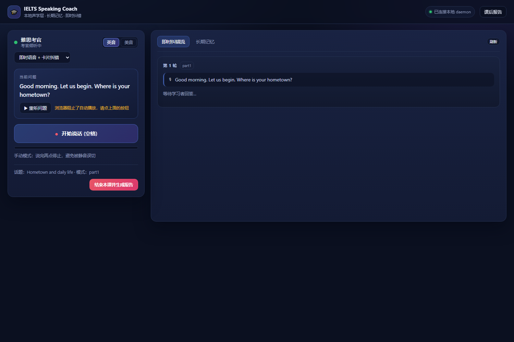
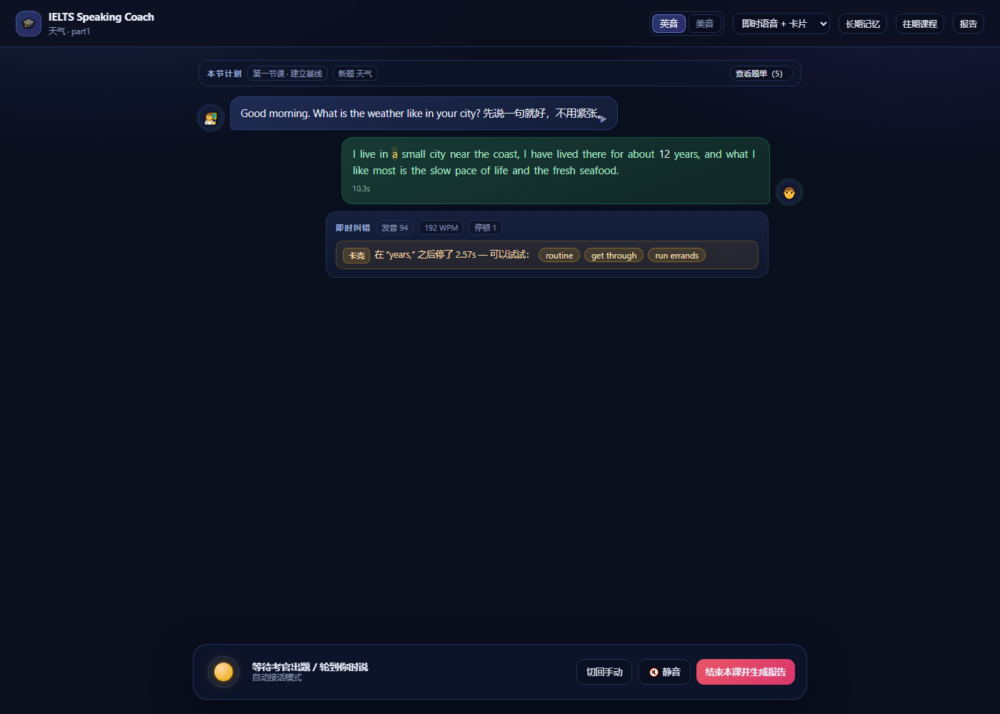

# 实现说明（IELTS Speaking Coach）

> **Phase 2 已完成**：声学发音引擎（GOP）+ 连麦式即时问答界面改版 + Silero VAD 自动断句。
> 详见 **[docs/PHASE2_DELIVERY.md](docs/PHASE2_DELIVERY.md)**（含实测数据、差异复核、戴麦验收步骤）。
> 本文以下内容仍是对 Phase 1 基础层（daemon / DB / ASR / TTS / MCP / 报告）的说明。

本文记录本仓库 **Phase 1** 的实际实现方式、运行方法、配置项与验收对应关系。
设计依据：`DESIGN_SPEC.md`、`BUILD_PLAN.md`、`database/schema.sql`、`skills/ielts-speaking-coach/SKILL.md`。

---

## 1. 本机环境（已探测并适配）

| 项目 | 实测结果 |
| :--- | :--- |
| 操作系统 | Windows 10 Pro (AMD64) |
| GPU | NVIDIA GeForce RTX 4070 SUPER 12 GB（CUDA 12.6，torch 2.9.1+cu126，CUDA 可用） |
| Python | 3.12.10（独立虚拟环境 `.venv`，不使用系统 conda 环境） |
| Node.js | v24.19.0（用于编译 `web_src`） |
| espeak-ng | 1.52.0（已通过 winget 安装到 "C:\Program Files\eSpeak NG"，Phase 2 G2P 需要） |
| spaCy 模型 | en_core_web_sm 3.8.0（Kokoro 英文 G2P 依赖，必需） |
| 模型缓存 | HuggingFace 镜像 `https://hf-mirror.com`（本机无法直连 huggingface.co 时自动启用） |
| ffmpeg | 未安装，且**不需要**（录音走 Web Audio 直采 16 kHz PCM WAV） |

---

## 2. 目录结构（已实现）

```text
ielts-coach-plugin/
├── daemon/
│   ├── config.py            # 路径/端口/硬件探测/espeak 自检/HF 镜像
│   ├── db.py                # SQLite 初始化 + 全部 CRUD 与长期记忆聚合
│   ├── main.py              # FastAPI：REST + WebSocket + 静态面板托管
│   ├── state_machine.py     # 会话状态机 + 40 秒安全长轮询
│   ├── audio/
│   │   ├── processor.py     # 16 kHz WAV 校验/重采样/能量 VAD/静音裁剪
│   │   ├── asr.py           # Faster-Whisper 常驻 + 流利度指标（WPM/停顿/虚词）
│   │   ├── tts.py           # Kokoro-82M 常驻 + 文本哈希缓存（英音/美音）
│   │   └── pronunciation.py # Phase 2 预留（GOP）
│   └── static/              # web_src 构建产物（daemon 直接托管）
├── mcp_bridge/server.py     # FastMCP/MCPServer：9 个工具 + daemon 自动拉起
├── web_src/                 # React + Vite + TS 伴生前端源码
├── scripts/
│   ├── install.py           # 一键注册 MCP + Skill（dsh / Claude / Cursor）
│   ├── selftest_audio.py    # Kokoro -> WAV -> Whisper 往返自检
│   └── smoke_mcp_stdio.py   # 以 MCP stdio 协议真实握手并调用工具
├── tests/                   # 22 个自动化测试
└── database/schema.sql
```

> `daemon/audio/pronunciation.py` 留空实现属于 Phase 2（GOP），Phase 1 不伪造发音数据，
> `pronunciation` 字段在每轮返回中明确为 `null` 并附说明。

---

## 3. 一键使用

### 3.1 启动

```powershell
cd E:\雅思口语插件开发
.\.venv\Scripts\python.exe -m daemon.main          # 启动常驻守护进程（127.0.0.1:8765）
.\.venv\Scripts\python.exe -m daemon.main --doctor # 环境自检
```

通常**不需要手动启动**：MCP Bridge 第一次被调用时会自动后台拉起 daemon，并把日志写到
`~/.ielts-coach/logs/daemon.log`。

### 3.2 伴生面板长什么样



左侧是考官区（状态灯 / 当前问题 / 重听 / 超大录音按钮 / Part 2 计时器 / 结束课程），
右侧是即时纠错流（每轮一张卡片）与长期记忆两个标签页。

### 3.3 在 dsh 里使用

1. 已注册 `ielts-coach` MCP Server 与 `ielts-speaking-coach` Skill（见第 6 节）。
2. 重启 dsh，新开一个任务，说：**“开始练雅思 Part 1”**。
3. 智能体会依次调用 `get_learner_context` → `start_lesson` → `respond_with_feedback_and_wait`。
4. 伴生面板自动打开（`http://127.0.0.1:8765/?session=<id>`）。

---

## 4. 每轮对话的完整数据流

```text
Agent(LLM)                    MCP Bridge                Daemon                     Browser
   |                              |                       |                           |
   |-- respond_with_feedback_and_wait(examiner_text, feedback_payload) -->|           |
   |                              |-- POST /examiner_turn ->| 存上一轮纠错卡片          |
   |                              |                       |-- WS feedback ----------->| 右侧卡片
   |                              |                       |-- Kokoro 合成 24k WAV ---->| 自动播放
   |                              |-- GET /wait (≤40s) -->| 状态=waiting_for_learner  |
   |                              |                       |<--- POST /audio (16k WAV) | 学习者录音
   |                              |                       | Whisper 转写 + 流利度      |
   |                              |<-- learner_replied ---| 状态=learner_replied      |
   |<-- transcript/wpm/pauses ----|                       |                           |
```

**关键点**

* 一轮对话只消耗 **1 次 LLM 推理 + 1 次 MCP 调用**（纠错与提问合并）。
* 所有等待接口单次最长 **40 秒**（可用 `IELTS_COACH_MAX_WAIT` 调整，服务端二次截断），
  超时返回 `waiting_for_learner` / `recording_in_progress` 而**不是异常**，Skill 会静默续等。
* 学习者点“结束本课”时，所有挂起的长轮询立刻返回 `lesson_ended_by_user`，Agent 随即出报告。

---

## 5. 配置项（环境变量）

| 变量 | 默认 | 说明 |
| :--- | :--- | :--- |
| `IELTS_COACH_HOME` | `~/.ielts-coach` | 数据根目录（DB / 录音 / 报告 / 日志） |
| `IELTS_COACH_HOST` / `IELTS_COACH_PORT` | `127.0.0.1` / `8765` | 守护进程监听地址 |
| `IELTS_COACH_DEVICE` | 自动 | `cuda` > `mps` > `cpu` |
| `IELTS_COACH_ASR_MODEL` | CUDA 下 `large-v3-turbo`，否则 `medium.en` | Faster-Whisper 模型 |
| `IELTS_COACH_ASR_COMPUTE` | CUDA `float16` / CPU `int8` / MPS `float32` | 推理精度 |
| `IELTS_COACH_VOICE_UK` / `_US` | `bf_emma` / `af_heart` | Kokoro 音色 |
| `IELTS_COACH_TTS_SPEED` | `1.0` | 语速 |
| `IELTS_COACH_MAX_WAIT` | `40` | 单次长轮询上限（秒） |
| `IELTS_COACH_PAUSE_THRESHOLD` | `0.8` | 计为“明显停顿”的间隙（秒） |
| `IELTS_COACH_STUB_MODELS` | `0` | `1` = 用确定性假模型（测试/CI） |
| `IELTS_COACH_HF_MIRROR` | `https://hf-mirror.com` | 直连 HF 失败时自动使用 |
| `IELTS_COACH_NO_BROWSER` | `0` | `1` = start_lesson 不自动打开浏览器 |

---

## 6. 注册情况

`scripts/install.py` 会做三件事：

1. `pip install -e .`（editable，生成 `.venvScriptsielts-mcp.exe`）；
2. 把 `skills/ielts-speaking-coach/SKILL.md` 复制到 `~/.dsh/skills/ielts-speaking-coach/` 与 `~/.agents/skills/`；
3. 在 `~/.dsh/profiles/<profile>/cordis.patch.yml` 里追加 `mcp-ielts-coach` 的
   `@deepseek-ai/dsh-mcp-client` 条目（先备份原文件），并顺带写入 Claude Code / Desktop / Cursor 配置。

> dsh 的 MCP 配置改动需要**重启 dsh** 才会加载。

---

## 7. 测试

```powershell
.\.venv\Scripts\python.exe -m pytest tests -q
```

| 测试文件 | 覆盖内容 |
| :--- | :--- |
| `tests/test_db.py` | 建表幂等、画像、会话/轮次 CRUD、JSON 列、语法错题统计、记忆 upsert、聚合、报告与历史 |
| `tests/test_asr_fluency.py` | WPM/停顿/虚词计算、WAV 往返、拒绝 webm/mp4、重采样、VAD 裁剪、上传规范化、stub ASR |
| `tests/test_mcp_e2e.py` | 真实 uvicorn + MCP Bridge 两轮对话、超时状态机、录音状态、聚合、记忆、报告落盘、结束课程解锁等待 |

---

## 8. Phase 1 验收对照

| 验收项 | 状态 | 说明 |
| :--- | :--- | :--- |
| `pytest` 三个测试文件全通过 | ✅ | 22 passed |
| dsh 安装后单开任务即可拉起面板 | ✅ | MCP + Skill 已注册，Bridge 自动拉 daemon |
| 3 轮以上语音对话、3~5 秒内出纠错卡片 | ✅ | 转写+流利度约 1~2 秒（GPU），卡片由 Agent 一轮返回后立即推送 |
| 结束本课生成 `.md` 报告 | ✅ | 写入 `~/.ielts-coach/reports/` 并切到报告视图 |
| 新任务能回忆上次事实/错题 | ✅ | `get_learner_context` 返回语法顽疾、弱音素、Part 2 素材、上节处方 |

---

## 9. 已知限制（Phase 2 解决）

* 发音分数目前为 `null`：没有 GOP 声学评测前不编造分数，PR 维度在报告里标 `N/A (Phase 1)`。
* 单词级“我的原声 vs 标准示范”对比需要音素时间戳，Phase 2 提供；
  Phase 1 已具备整轮原声回放与任意文本/单词的 Kokoro 示范音接口
  （`/api/tts/word`、`/api/tts/say`）。
* VAD 使用能量阈值（无需额外模型）；Silero VAD 可在 Phase 2 作为可选增强接入。

---

## 10. 实测性能（RTX 4070 SUPER / i7 级 16 线程）

| 环节 | 实测 | 说明 |
| :--- | :--- | :--- |
| daemon 启动 | 2.5 s | 模型在后台预热，接口立即可用 |
| ASR（large-v3-turbo, fp16） | **0.66 ~ 0.88 s** | 17.8 s 长录音，54 词，3 次重复测量 |
| TTS（Kokoro-82M, fp16） | **0.11 ~ 0.14 s** | 2.9~6.0 s 英文句子，预热后 |
| 持久化 + 流利度计算 | < 0.05 s | SQLite WAL |
| 模型冷启动（首次） | 约 7~10 s | 只发生一次，之后常驻 |

一轮对话的端到端延迟 ≈ ASR 0.7 s + 你的 LLM 推理 + TTS 0.15 s。

---

## 11. 本机适配上踩到的坑与修复（都已写进代码，换机可复用）

1. **PyPI 的 Windows torch 是 CPU 版**
   → 从阿里云镜像装 `torch-2.9.1+cu126` / `torchaudio-2.9.1+cu126`，`cuda.is_available()` 为 True。

2. **中文用户名导致 PyTorch 抛 UnicodeDecodeError**
   torch 在 `%TEMP%\torch\kernels` 建缓存失败时打印一条含 GBK 中文路径的警告，
   pybind11 按 UTF-8 解码失败，异常落在毫不相干的 `torch.abs()` 上。
   → `config.ensure_ascii_tempdir()` 在加载模型前把 `TEMP/TMP` 指向纯 ASCII 目录
   （`E:\ielts-coach-tmp` 或 `%PROGRAMDATA%\ielts-coach\tmp`）。

3. **Kokoro 英文 G2P 需要 spaCy 模型**
   `misaki.en` 强制 `spacy.cli.download('en_core_web_sm')`，而该命令依赖
   `raw.githubusercontent.com`（本机不可达）。
   → 已通过镜像安装 `en-core-web-sm-3.8.0` wheel；缺失时 TTS 会给出明确安装提示。

4. **faster-whisper 与新版 PyAV 不兼容**
   `av.open(..., metadata_errors=...)` 在某些 PyAV 版本已移除。
   → ASR 直接用 `wave` 读 16 kHz WAV 并传 numpy 数组给 Whisper，**完全绕开 PyAV/ffmpeg**。

5. **huggingface.co 不可直连**
   → daemon 启动时探测连通性，失败则自动设 `HF_ENDPOINT=https://hf-mirror.com`。

6. **MCP SDK 2.x 把 FastMCP 改名为 MCPServer**
   → `mcp_bridge/server.py` 同时兼容 `mcp.server.mcpserver.MCPServer`（2.x）与
   `mcp.server.fastmcp.FastMCP`（1.x）。dsh 侧已成功连接并有 9 个工具。
---

## 12. 题库与课程编排（Phase 2.5）

**动机**：原先流程让学习者自己点话题，且每节课彼此独立。现在改为「题库随机出题 + 记忆驱动的复习/新课螺旋」：
学习者永远不需要选话题，第 2 节课起自动复习上次的薄弱点。

### 12.1 题库
- 位置：`daemon/content/question_bank.json`（纯数据，改完重启 daemon 生效，不用改代码）
- 规模：Part 1 **18** 个话题（每话题 5 问）、Part 2 **24** 张题卡、Part 3 **12** 组讨论，共 **162** 题
- 每条含 `id` / `topic` / `topic_zh` / `tags` / `questions`；Part 2 用 `title` + `bullets` + `follow_ups`

### 12.2 编排算法（`daemon/planner.py`）
```
新课程 = 复习块（来自长期记忆） + 新题块（题库随机，避开最近 8 个已用话题）
```
- **选题**：`topic_hint` 为空时从题库随机；传入提示时先按 id/标题/中文名/tags 模糊匹配
- **轮换**：`topic_usage` 表记录使用次数与时间，最近 8 个话题不进候选池
- **复习块**（`plan.review`）：
  - `grammar_patterns`：出现频次最高的 3 条语法顽疾
  - `weak_phonemes`：GOP 平均分最低的 3 个音素
  - `revisit_questions`：历史上错得最多的 3 道题（带 session_id / 错误数）
  - `story_to_polish`：已有的 Part 2 素材，提示复用而不是重新编
  - `last_plan`：上节课处方
- **结构**：有历史时，题单第一条固定是 `kind="revisit"` 的旧题；之后才是新题
- **full_mock**：Part 1（3 问）+ Part 2 题卡 + Part 3 讨论各抽一个话题
- **free_drill**：题单以 `revisit` 旧题为主，专攻顽疾
- 可传 `seed` 让结果可复现（测试用）

### 12.3 接口与协议变化
| 位置 | 变化 |
| :--- | :--- |
| `POST /api/sessions` | 新增 `auto_plan`（默认 true）：建课时自动出计划，写入 `lesson_plans` 表并记录话题使用 |
| `GET /api/plan?part_mode=&topic_hint=&seed=` | 只预览计划，不建课、不写库 |
| `GET /api/sessions/{id}/plan` | 读取某节课的题单 |
| `GET /api/sessions/{id}` / `bootstrap` | 响应里带 `plan` |
| MCP `start_lesson` | 返回值新增 `plan`；`topic_hint` 可以留空（建议留空） |
| MCP `get_lesson_plan(session_id)` | **新增工具**，题单丢了就重新取 |
| `health` | 新增 `question_bank` 计数 |
| `SKILL.md` | 明确「绝不问用户选话题」+ 「题干原样照念」+ 「题单念完再自行追问 1-2 题」 |

### 12.4 前端
顶栏下方新增 **本节计划条**：复习的语法模式 / 含几道旧题 / 新题话题 / 「查看题单」抽屉（列出每题的 新题·题卡·复习 标签与全文）。


### 12.5 新增测试
`tests/test_planner.py`（10 个）：题库完整性、首课无复习块、seed 可复现、topic_hint 生效、轮换避开最近话题、
复习块来自记忆、Part 2 题卡格式、full_mock 三段齐全、free_drill 优先旧题、使用记录落库。

全量：**50 passed**（原 40 + 10）。
---

## 13. 教质感：神经语音 + 双语 + 卡壳提示

### 13.1 双引擎 TTS
| 引擎 | 音色 | 优点 | 代价 |
| :--- | :--- | :--- | :--- |
| `edge`（默认） | `en-GB-SoniaNeural` / `en-US-AriaNeural` / `zh-CN-XiaoxiaoNeural` | 接近真人、有语调起伏、支持中英切换 | 需要联网，单句约 1.2~3s |
| `kokoro`（离线兜底） | `bf_emma` / `af_heart` | 全离线、约 0.15s | 82M 小模型，机械感更明显 |

- 引擎选择：`IELTS_COACH_TTS_ENGINE=auto|edge|kokoro`（auto = 探测得到 edge 就用，失败自动回落并 5 分钟后重试）
- 实测：英文单句合成 **1.16~2.3s**，中英混排 **1.6~3.0s**（分段并行）
- 缓存键包含引擎 + 音色 + 语速，重复文本 0ms 命中

### 13.2 双语合成（这是"双语教学"的听感来源）
一句话里中英混排时，按**句子**判语种再分别选音色，最后拼接（句间 120ms 停顿）：

> "Nice answer. 注意 think 里的 θ 音，舌尖轻触上齿。Now, what do you like most about it?"
> → 英音(Sonia) + 中文(Xiaoxiao) + 英音(Sonia)

注意：小语种切换按句子而不是按词，否则 "think""θ" 会被切出来单独合成（实测 7 段网络调用 10.6s，改完后 1.58s）。

### 13.3 卡壳识别与提示词
- **判定**：句中停顿 ≥2.0s，或犹豫词 ≥4 且最长停顿 ≥1.2s，或"不到 8 词却有 ≥2 个犹豫词"
- **提示词**：`daemon/content/hints.json`（31 个 tag / 229 个词），按当前题目的 tag 取，排除本次已说过的词
- **输出**：每轮 `payload.stuck = {detected, longest_pause_sec, at_word, hint_words[]}`，写进 `turns.long_pauses_json.stuck`，气泡下方显示「卡壳 … 可以试试：routine / get through」
- **智能体侧**：`SKILL.md` 要求 `stuck.detected` 为真时，先用一句中英混排给提示，再继续出题
- **实时信号**：Silero VAD 在"已开口但静默 ≥2.5s"时向浏览器推 `stuck: true`，为后续"考官主动插话"留接口



### 13.4 新增测试
`tests/test_hints.py`（11 个）：双语切分（整句、混排、连续同语种合并、空串）、提示词按 tag 取词/去重/兜底、
已用词提取、卡壳三档判定。

全量：**61 passed**。
