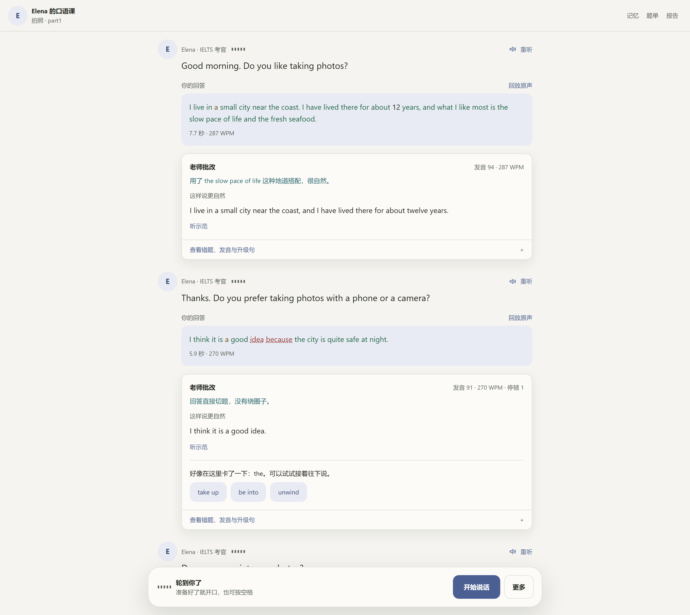

# 雅思口语教练 · IELTS Speaking Coach

> **在你常用的开发工具里说一句「开始上课」，弹出一个独立的桌面窗口陪你练口语。**
> 出题、识别、发音评分、纠错、记忆全部跑在本地；不联网也能用。



## 它是什么

一个**桌面伴侣软件**，不是网页：

- **独立窗口**（WebView2 / WebKit 原生窗口，没有地址栏、没有标签页），可以放在编辑器旁边，关掉编辑器它还在
- **由你的 AI 开发工具驱动**：在 dsh / Cursor / VS Code / Claude Code 里说「开始练雅思 Part 1」，窗口自己弹出来
- **本地常驻服务**：语音模型、题库、评分、记忆都在你机器上，音频不出本机
- **记忆跨课程、跨工具**：今天在 Cursor 里练的，明天在 dsh 里继续，它记得你上次错在哪

## 安装

### 方式 A：下载即用（**机器上不需要 Python**）

到 [Releases](../../releases) 挑一种：

| 方案 | 下载 | 大小 |
| :--- | :--- | :--- |
| **完整版（推荐）** | `IELTS-Coach-full.zip.001` + `.002` + `合并并解压.bat` | 3.2 GB（分卷） |
| 轻量版 | `IELTS-Coach-portable-win64.zip` | 1.38 GB |
| 分体版 | `IELTS-Coach-app.zip` + `IELTS-Coach-models-large.zip` | 623 MB + 1.66 GB |

- **完整版**：三个文件放同一文件夹 → 双击 `合并并解压.bat`（用 Windows 自带的 `tar`，不需要装 7-Zip）→ 双击 `启动口语教练.bat`。识别模型 `distil-large-v3`，质量最好。
- **轻量版**：一个包，解压即用，识别模型 `small.en`。
- **分体版**：两个 zip 解压到同一文件夹，效果同完整版，适合网速不稳时分开下。

GitHub 单文件上限是 2 GB，所以完整版拆成两个分卷（每卷 1.8 GB 以内）。

- 内置 Python 运行时和全部依赖，不碰系统环境
- **语音模型和题库都在包里**：识别、发音评分、离线合成、断句，首次启动不联网
- 想清空所有记忆：删除 `%USERPROFILE%\.ielts-coach`

安装包 **1.38 GB**（GitHub 单文件上限 2 GB）。内部构成：程序 450 MB + 模型 1.15 GB。

### 方式 B：让你的 AI 工具自己装

在 dsh / Cursor / Claude Code 里新建一个任务，直接说：

> 下载 GitHub 上的 https://github.com/<你的用户名>/ielts-coach-plugin ，按 README 安装到我本机，然后开始上课。

Agent 会克隆、建 venv、装依赖、注册 MCP、装桌面入口。

### 方式 B：手动

### 方式 C：开发者（需要 Python 3.11+）

```bash
git clone https://github.com/<你的用户名>/ielts-coach-plugin
cd ielts-coach-plugin

# Windows
powershell -ExecutionPolicy Bypass -File setup.ps1

# macOS / Linux
bash setup.sh
```

### 自己打包便携版

```bash
python scripts/build_portable.py     # 产出 dist/IELTS-Coach-portable-win64.zip
```

看到 `v1.0.0` 这样的 tag 时，GitHub Actions 会自动构建并挂到 Release 上（`.github/workflows/release.yml`）。

## 怎么用

1. 在任意支持 MCP 的工具里开一个任务，说：**「开始练雅思 Part 1」**
2. **桌面窗口自动弹出**，点一次「开始语音连麦上课」授权麦克风
3. 考官说英文 → 你回答 → 停顿 2.6 秒自动接话
4. 卡壳时（停顿 2 秒）窗口会先给提示词，你可以直接说下去
5. 结束后说出报告，或点「更多 → 结束本课」

已经在上课时想再打开窗口：说 **「打开口语教练」**，或双击 `ielts-coach`。

## 支持哪些工具

| 工具 | 接入方式 | 入口 |
| :--- | :--- | :--- |
| **DeepSeek Harness (dsh)** | MCP + SKILL | 说「开始上课」 |
| **Cursor / VS Code / Windsurf** | MCP + SKILL + 扩展 | 命令面板 `IELTS: 打开口语教练面板` / 状态栏 🎤 |
| **Claude Code** | MCP + SKILL | 说「开始上课」 |
| **任何 MCP 客户端** | `ielts-mcp` | 调 `start_lesson` |

## 能力取决于你的本地模型

| 组件 | 需要 | 没有 GPU 时 |
| :--- | :--- | :--- |
| 语音识别 | faster-whisper `large-v3-turbo` | CPU 可用，慢 3–5 倍 |
| 发音评分 | wav2vec2 + GOP | CPU 可用（每句 < 1 秒） |
| 语音合成 | edge-tts（更自然，需联网）| 自动回落到本地 Kokoro，全离线 |
| 断句 | Silero VAD | 纯 CPU，实时 |

启动时 `http://127.0.0.1:8765/health` 会报告每个组件的真实状态，缺哪个都会降级而不是崩。

## 数据与隐私

- 所有音频只发往 `127.0.0.1:8765`，**不上传任何服务器**
- 数据目录：`~/.ielts-coach/`（数据库、录音、报告、日志）
- 卸载：删除仓库目录 + `~/.ielts-coach` 即可

## 目录结构

```text
daemon/          本地服务：模型、录音、发音评分、题库、记忆、报告
desktop/         桌面窗口（pywebview，单实例，自动跟随当前课程）
mcp_bridge/      MCP 服务：给 dsh / Cursor / Claude Code 调
web_src/         界面源码（React + Vite，构建到 daemon/static）
editors/vscode/  VS Code / Cursor 扩展（可选）
skills/          SKILL.md：教 AI 怎么当口语考官
scripts/         安装器、E2E、演示数据
docs/            交付记录与截图
```

## 开发

```bash
pytest tests -q           # 61 个测试
cd web_src && npm run build   # 构建界面
python -m desktop.app --session 1   # 直接开窗口调试
```

详细设计见 [IMPLEMENTATION.md](IMPLEMENTATION.md)、[DESIGN_SPEC.md](DESIGN_SPEC.md)、[Deliverable 2.0](docs/DELIVERY_V2.md)。

## 已知限制

- **便携版目前只有 Windows x64**（macOS / Linux 走开发者方式，需要 Python）
- 桌面窗口依赖 WebView2（Win10/11 自带；老系统需装 [WebView2 Runtime](https://developer.microsoft.com/microsoft-edge/webview2/)）
- 为了塞进 2 GB，包里是 `small.en` 识别模型 + int8 量化的发音模型：
  想换更大模型，设置 `IELTS_COACH_ASR_MODEL`（会联网下载，首次约 1.5 GB）
- 发音模型量化后与 fp32 的 CTC top-1 一致率是 **1.0000**，评分行为不变，但只能用 CPU 推理
- edge-tts 需要联网；离线时自动用本地 Kokoro（音色略机械）
- 目前只支持英文口语练习
