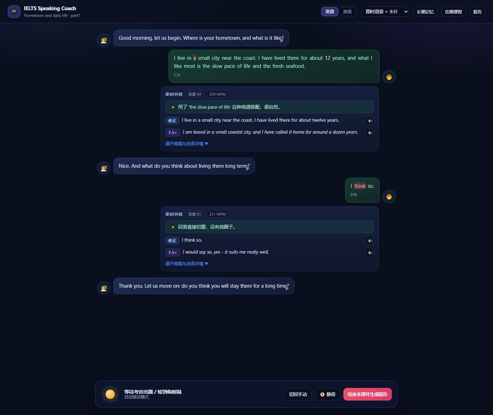
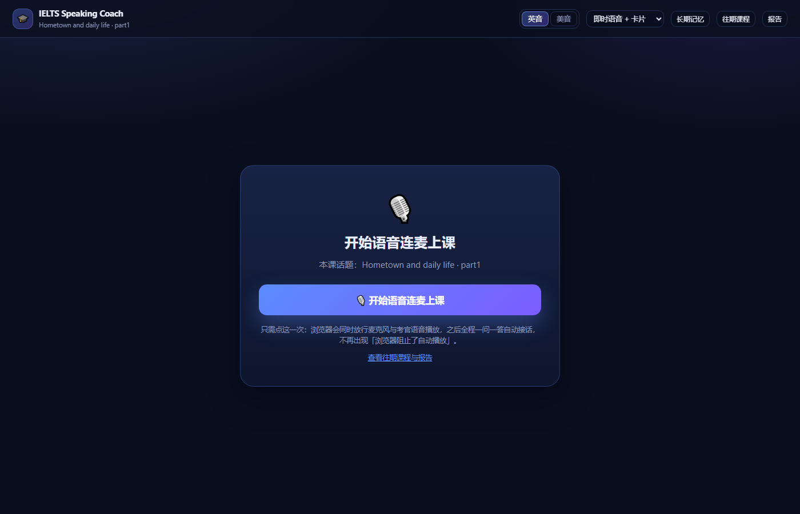

# Phase 2 交付：声学发音引擎 + 连麦式即时问答界面

> 对应 `PHASE1_REVIEW_AND_PHASE2_HANDOFF.md` 的正式拍板与指令，本轮已全部落地。
> 读者假定没有对话上下文；所有结论附可复现命令与文件位置。
> 上一阶段文档：`docs/PHASE1_DELIVERY.md`。

---

## 0. 结论速览

| 指令 | 状态 | 证据 |
| :--- | :--- | :--- |
| D1 保留 10 个 MCP 工具并同步文档 | ✅ | `DESIGN_SPEC.md` §5 已改为「10 个（8 核心 + 2 辅助）」；`SKILL.md` 增加 `daemon_status` / `end_lesson` 用法；已重新安装到 `~/.dsh/skills/` 与 `~/.agents/skills/` |
| D2 引入 silero-vad 作为默认自动断句 | ✅ | 新增 `daemon/audio/vad.py` + `WS /ws/live/{session_id}`；1.8 s 静音自动切段；前端保留手动模式开关 |
| D11 不硬切 examiner_text | ✅ | 未改 daemon 台词逻辑，仍由 SKILL.md 约束 |
| Part 2：1 分钟准备（可跳过）→ 开口自动切 2 分钟计时 | ✅ | `Part2State` 状态机 + 浮动计时卡 |
| 顶部轻量「往期课程/报告」抽屉 | ✅ | `HistoryDrawer.tsx`，可回看历史课程并切换 |
| 不做 Windows 开机自启 | ✅ | 维持 MCP 首次调用按需拉起 |
| 连麦式一键开课 / 自动接话 / 气泡流 / 底部 Dock | ✅ | 见 docs/ui-gate.png、docs/ui-chat.png |
| Phase 2 GOP 音素级发音评估 | ✅ | `daemon/audio/pronunciation.py`；think→sink 稳定检出（59 分红词 + θ→s） |
| `tests/test_gop_pronunciation.py` + 全量回归 | ✅ | **40 个测试全部通过**（新增 11 GOP + 7 VAD） |

**尚未完成的一步**：真人戴麦实测（需要你本人对着麦克风说几轮）。见第 7 节启动步骤。

---

## 1. 界面：从「语音识别工具」改成「连麦式即时问答」

| 旧交互（Phase 1） | 新交互（Phase 2） |
| :--- | :--- |
| 首屏直接是控制台，右栏空白等待 | 首屏一张卡：**🎙️ 开始语音连麦上课**（点一次同时解锁麦克风 + 音频播放权限，不再出现"浏览器阻止自动播放"） |
| 每轮手动点"开始说话 / 停止并提交" | 默认**考官说完自动开麦**，Silero VAD 判定停顿 1.8 s 自动提交；底部可一键切回手动 |
| 左控台 + 右表单列表 | **居中对话气泡流**：左考官气泡（带重听）、右学习者气泡（提交后立刻出转写） |
| 纠错卡片独立堆叠 | 纠错**紧凑挂在对应学习者气泡下方**：亮点表扬 + 语法修正 + 7.5+ 升级一行呈现，点"展开"才看错题与发音详情 |
| 无发音可视化 | 学习者原句**逐词红黄绿热力标色**；点单词弹出音标抽屉 |

底部 Live Voice Dock：状态球（考官正在说 / 正在听你说 / 思考与批改中）+ 重听 + 自动↔手动 + 静音 + 结束本课。





---

## 2. Phase 2 声学发音引擎（GOP）

### 2.1 管线

```text
16k WAV ──► Wav2Vec2 (facebook/wav2vec2-xlsr-53-espeak-cv-ft, fp16)
              └─► 帧级音素后验 [T, 392]  (20ms/帧)
ASR 词表 ──► G2P (espeak-ng / phonemizer，按口音用 en-gb 或 en-us)
              └─► 音素序列（严格按模型词表做最长匹配切分：iː / aɪ / əʊ 是单 token）
              └─► CTC 强制对齐 (torchaudio.functional.forced_align，含 numpy Viterbi 兜底)
              └─► 每个音素的帧区间 + GOP = logP(目标) − max logP(其他音素)
              └─► 0~100 分（sigmoid）；词分 = 0.65*均值 + 0.35*最差分
```

**并行执行**：上传接口里用 asyncio.gather 同时跑 faster-whisper 与 wav2vec2 前向，只有便宜的"对齐+GOP"等转写结果；实测一轮 ASR+发音合计 **0.3~0.5 s**（GPU）。

**落库**：`turns.pronunciation_score`、`turns.pronunciation_json`（逐词/逐音素明细），以及 `pronunciation_issues` 表（每个真实问题一行）。MCP 返回值里 `pronunciation` 字段直接透传给 agent，`SKILL.md` 已要求 agent 必须引用这里的数据、不得自己编发音。

### 2.2 关键实现决策（值得复核）

1. **按口音做 G2P**：英音 en-gb / 美音 en-us 互换会让 /ɒ/ vs /ɑ/、/eə/ vs /ɛr/ 全部判错——实测同一段美国音频用英音 G2P 时整句冒出 10 个红词。现在 daemon 从 `learner_profile.accent_preference` 取口音，与考官音色保持一致。
2. **同族音素等价表**：əʊ↔oʊ↔o、ɹ↔r、ɛ↔e、iː↔i、ɜː↔ɚ、ə↔ɐ 等按口音变体放行，且不参与"竞争音素"比较。这消除了「英音əʊ被听成美音oʊ」的假红。
3. **短功能词元音宽容**：单音节且 ≤3 个音素的词（a / of / and / what / there），元音差异视为口音差异不报错；**辅音替换照旧计分**（think→sink 不受影响，因为 think 有 4 个音素）。
4. **检测到替换就压分**：只要某音素的"实际听到的音素"与目标不同且 GOP < -1.0，该词直接封顶 59 分（红）。原因：GOP 幅度会随裁剪/增益变化，但"听成别的音"是硬证据。
5. **不用 torchaudio 就降级**：forced_align 已在 2.9 标记废弃，代码先用它，异常时自动切到自带的 numpy CTC Viterbi（两套实现跑同一批用例）。

### 2.3 实测（RTX 4070 SUPER，真模型）

| 项 | 实测 |
| :--- | :--- |
| 音素模型加载 | 3.1 s（串行预热阶段；并发时曾因争抢飙到 42 s，已改为错峰） |
| wav2vec2 前向（0.9 s 音频） | 0.02~0.06 s |
| 对齐 + GOP 计算 | 0.01~0.02 s |
| 单轮 ASR + GOP 总耗时 | **0.32~0.50 s**（远低于验收线 GPU 2 s） |
| Silero VAD 单帧（32 ms） | 0.68 ms（CPU 实时无压力） |

### 2.4 验收用例（真实音频）

用 Kokoro 生成两段音频：`I think so.` 与 `I sink so.`（后者把 /θ/ 读成 /s/），都按"期望文本 = I think so"评测：

| 音频 | think 词分 | 颜色 | 检出问题 | 整句分 |
| :--- | :--- | :--- | :--- | :--- |
| 正确发音 | 99 | 绿 | — | 94.7 |
| 读成 sink | **59** | **红** | **θ → s, GOP -1.52** | 81.3 |

真实 daemon 管线（含 Whisper 转写）复现同一结论：上传 sink 音频 → Whisper 仍转写为 "I think so."（语言模型自动纠错）→ GOP 判定 think 为红并写入 `pronunciation_issues`（word=think, phoneme=θ, gop=-1.52）。

---

## 3. Silero VAD（默认自动断句）

- `daemon/audio/vad.py`：`VADService`（torch.jit 常驻）+ `StreamingVAD`（每连接状态机：语音起点、尾部静音、超长保护、无语音超时、手动 flush）。
- `WS /ws/live/{session_id}`：浏览器推 512 帧（32 ms）int16，服务端逐帧推理并回 {prob, speech, trailing_silence, should_stop, stop_reason}；尾部静音 ≥1.8 s 即 stop_reason=silence。
- 前端 `audio/liveSession.ts`：连麦时开麦 → 分帧推流 → 收到 stop 自动停录并上传；**服务端不可用时自动回落到本地能量 VAD（同样 1.8 s）**，并提示一次。
- 实测：注入 1.2 s 音调 + 静音，服务端在 1.82 s 处返回 should_stop=true / stop_reason=silence；reset 与手动 flush 均正常。

---

## 4. 数据库与报告变化

| 位置 | 变化 |
| :--- | :--- |
| `turns.pronunciation_score` / `pronunciation_json` | 现在真实写入（Phase 1 为 null） |
| `pronunciation_issues` | 每个检出问题一行（word / expected_ipa / phoneme / issue_type / gop_score / word_score / 起止时间） |
| 报告 PR 维度 | agent 现在可以基于真实 GOP 打分（SKILL.md 已要求引用 pronunciation.overall_score 与 weak_phonemes） |
| `get_lesson_aggregation` | 新增 avg_pronunciation_score 与 pronunciation_issues 明细（此前表空） |

---

## 5. 测试

```powershell
.\.venv\Scripts\python.exe -m pytest tests -q
```

**40 passed**：test_db.py 8 + test_asr_fluency.py 9 + test_mcp_e2e.py 5 + **test_gop_pronunciation.py 11** + **test_vad_streaming.py 7**。

GOP 测试分两层：
- **纯单元**（无需下载模型）：GOP 映射单调性、音量标定、IPA 最长匹配切分、numpy Viterbi 对齐、θ→s 合成用例、口音变体不误报、超长目标序列拒绝；
- **真模型集成**（模型不可用时自动 skip）：两段真实音频的对比断言 + 词级时间戳检查 + 单轮 < 2 s 预算。

---

## 6. 与设计文档/指令的差异（请复核）

| # | 指令/文档 | 实际实现 | 原因 |
| :--- | :--- | :--- | :--- |
| P1 | 「点击任意单词查看音标与发音技巧」 | 抽屉展示音标、逐音素分数、问题类型、GOP、原声片段与标准音两个按钮 | 发音"技巧文案"由 agent 在 pronunciation_tips 里给，前端不硬编码教学文案 |
| P2 | 「支持一键播放我的原声截取」 | 用 start_sec/end_sec 对已保存的整句录音做区间播放（±50/80 ms 余量） | 无需额外切片文件，秒开且不占磁盘 |
| P3 | 验收「CPU/Apple Silicon 下 < 4.5 s」 | 本机只有 CUDA 实测；CPU 路径已实现（int8/float32）但未实测 | 需在无 GPU 机器上补测 |
| P4 | 未提及 | 新增 ?preview=1（跳过连麦门禁直接看对话流，供截图/调试），不影响正常流程 | 方便复核与排障 |
| P5 | 未提及 | 新增 scripts/seed_demo.py（一键造一节演示课，含念错 think 的样本） | 便于你验收时立刻看到红词效果 |
| P6 | 未提及 | G2P 使用 learner_profile.accent_preference，不再是固定英音 | 见 2.2-1 |

### 已知限制（诚实说明）

1. **同形异读词**：espeak 对 live（动词 /lɪv/ vs 形容词 /laɪv/）等按自身词典选读音，可能给出与句意不同的音素；这类词目前靠"短词元音宽容"不误报，但无法保证 100% 正确。
2. **合成音 vs 真人**：以上验收用例的音频由 Kokoro 生成，音色干净。真人带口音、连读、轻声时，GOP 分布会不同，阈值（gop_center=-2.6、substitution_margin=1.5）可能需要按你试说的结果微调——都在 Settings 里，改环境变量即可，不用动代码。
3. **VAD 与「说完」的判定**：默认 1.8 s；若你习惯长停顿思考，建议先用手动模式（底部一键切换），或把 IELTS_COACH_VAD_SILENCE 调到 2.5。

---

## 7. 你现在怎么验收（真人戴麦）

1. 确认 daemon 在跑：浏览器打开 http://127.0.0.1:8765/health 应看到 ok:true（本机已由 MCP 自动拉起并常驻）。
2. 在 dsh 里**新开一个任务**，说：**「开始练雅思 Part 1，话题家乡」**。
3. 浏览器会弹出伴生页 → 点 **🎙️ 开始语音连麦上课**（只点这一次，授权麦克风）。
4. 考官播报完会自动亮麦，直接说话；**停 1.8 秒不用按键**，自动提交。
5. 你会看到：右侧学习者气泡先出转写 → 气泡下方出纠错卡（表扬/修正/7.5+）→ 原句逐词红黄绿地标色 → **点任意红/黄单词**弹出音标抽屉，可「听我的原声」与「听标准示范音」对比。
6. 想手动控制就点底部「切回手动」；想结束点「结束本课并生成报告」，agent 会用真实 GOP 数据打 PR 分。

排障：daemon_status 工具可看四个模型（asr / tts / vad / pronounce）是否 ready；日志在 ~/.ielts-coach/logs/daemon.log。

---

## 8. 复现命令

```powershell
cd E:\雅思口语插件开发

# 全量测试
.\.venv\Scripts\python.exe -m pytest tests -q

# Phase 2 真模型端到端（自起 8800 端口，含 think/sink 对比与耗时）
.\.venv\Scripts\python.exe scripts\e2e_phase2.py

# 造一节演示课（写进 daemon 当前数据库）
.\.venv\Scripts\python.exe scripts\seed_demo.py

# 重新构建前端
npm --prefix web_src run build

# 重新注册 MCP + 最新 SKILL.md
.\.venv\Scripts\python.exe scripts\install.py
```
